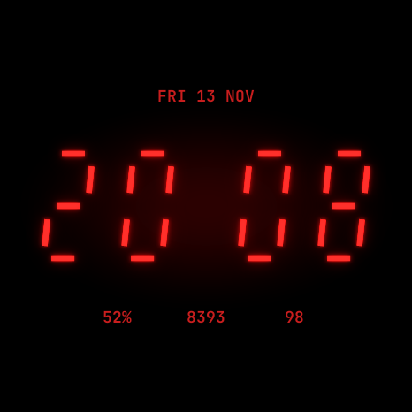
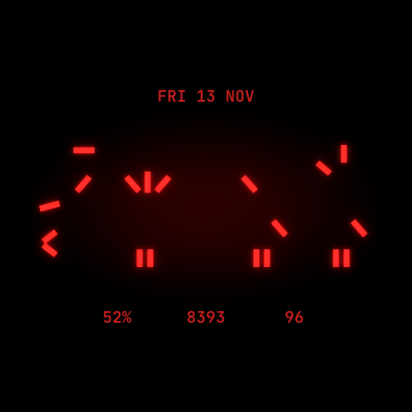
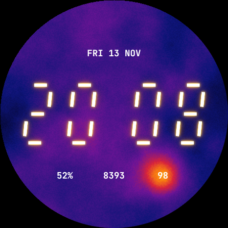

# Predator — watch face for Wear OS

A hunter's wrist display for round Wear OS watches (built for the OnePlus Watch 3, 466×466): bright red dashes on pure black. The display shows the time for two seconds, then runs through alien symbols for five, and keeps alternating for as long as the screen is on.

<p align="center">
  
  
  
</p>

The pictures are screenshots from the watch.

## The display

Everything is drawn with one stroke: a short, thin, flat-ended dash, with more gap than ink.

- **Time** — seven-segment digits whose segments are those dashes, leaning slightly, so the hour stays readable.
- **Running symbols** — clusters of dashes, rays and small chevrons around the centre of each cell. The lattice of fourteen marks and the fourteen symbols built from it are invented for this face (`PredatorRender.Mark`, `PredatorRender.Cluster`). All four cells change twice a second.

## Features

- Alternates 2 s of time and 5 s of running symbols while the screen is on, starting with the time on every wake
- Black background for OLED: the only lit pixels are the dashes, the small readouts and a faint red back-light behind the display
- Date above; battery, steps and heart rate in one small row below
- Tap for four seconds of thermal view
- Always-on mode: hairline digits only

## How it is built

Pure [Watch Face Format v2](https://developer.android.com/training/wearables/wff) — the APK contains resources only, no code. Every bitmap is rendered procedurally.

- `tools/PredatorRender.cs` draws the digits, symbols, running frames and thermal view; `tools/render.ps1` compiles and runs it into `res/drawable`.
- `tools/gen-xml.ps1` writes `res/raw/watchface.xml`.
- `tools/mock.ps1` composites a test frame locally, without a watch.
- `build.ps1` builds the APK without Gradle (aapt2 → zipalign → apksigner, debug key).

```powershell
.\tools\render.ps1
.\tools\gen-xml.ps1
.\build.ps1 -Install
```

Requires PowerShell 7, the Android SDK (build-tools 37, platform android-34) and a JDK.

## Install

Grab the APK from [Releases](../../releases) and sideload it with `adb install predator.apk`, then long-press the current watch face and pick **Predator**. Needs Wear OS 4 or newer.

The design, the symbols and all artwork are original to this project. Font: a bold monospace under the SIL Open Font License.
